<p align="center">
  
</p>

<p align="center">
  
</p>


```console
lena@github:~$ cat about_me.txt
```

```yaml
mindset: Passionate about learning and building meaningful tech projects
```

---


```console
lena@github:~$ ls ~/skills
```

<p align="left">
  
  
  
  
  
  
  
  <br/>
  
  
  
  
  
  
  
  
  <br/>
  
  
  
  
  
</p>


```console
lena@github:~$ ls ~/tools
```

<p align="left">
  
  
  
</p>

---


```console
lena@github:~$ ssh lets-connect
```

<p align="left">
  <a href="https://www.linkedin.com/in/lena-alenazi/">
    
  </a>
  <a href="mailto:lena.a.alenazi@gmail.com">
    
  </a>
</p>

---


```console
lena@github:~$ uptime --visitors
```

<p align="left">
  
</p>

---

<p align="center">
  
</p>

<p align="center">
  
</p>

```console
lena@github:~$ █
```
